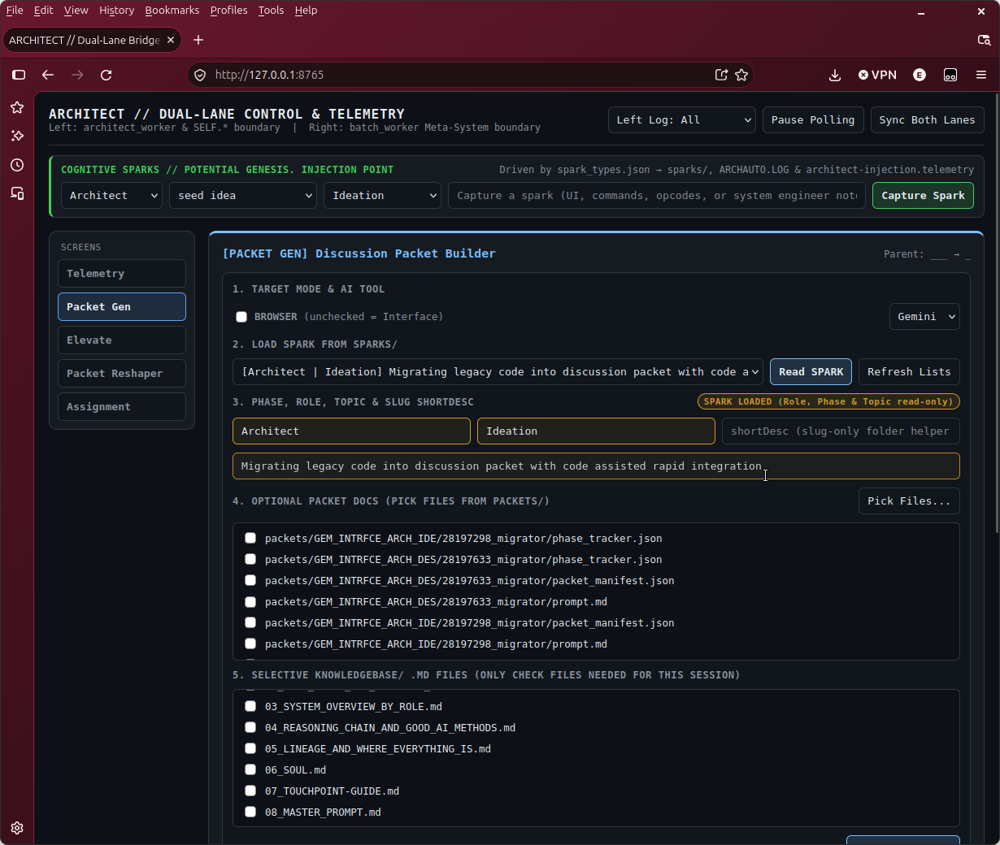

# Meta-Architect: The Architect Control Plane

*A human-centred AI development environment. Three roles. One control plane. A shared knowledge journey.*

## What is Meta-Architect?

Meta-Architect is an experimental development environment designed to make AI-assisted software development more controlled, observable and accessible.

Its central component is the **Architect Control Plane (ACP)**: a lightweight environment for capturing ideas, creating focused AI discussion packets, managing development workflows and evolving shared knowledge.

The system deliberately separates three roles:

- **Architect — AI enabled:** designs the environment, creates tooling, establishes contracts and orchestrates the system.
- **Engineer — No AI:** uses Architect-provided tools to build projects, assign design patterns, define lifecycle phases and assemble workflows.
- **User — AI guided:** participates in structured discussion packets, contributes ideas and develops understanding without managing the underlying AI complexity.

These are three distinct working roles, operated by one person. The Architect handles most of the complexity; the other roles are designed to be friction-free.

## Why create this system?

After a year of experimenting with AI, I had experienced the good, the bad and the ugly.

I'd built applications, experimented with automation, explored different AI platforms and discovered how quickly promising workflows could break.

I also had a particularly restrictive operating environment:

- A 4GB Dell laptop.
- Freemium AI services.
- Limited tokens and usage allowances.
- No dependence on GPU cloud infrastructure.
- A preference for non-agentic, human-directed workflows.

This combination became the design challenge.

### What did I learn?

AI is powerful, but it introduces failure modes that conventional software development doesn't always prepare you for.

Some of the recurring problems:

- **Topic drift:** discussions gradually lose their original purpose.
- **Hallucination:** generated information can be confidently incorrect.
- **Truncation:** long sessions and large outputs can be cut short.
- **Alignment:** the AI can lose sight of the intended objective.

Meta-Architect applies practical mitigations rather than pretending these problems have disappeared.

Short, focused discussions reduce context overload. Contract-driven packets establish boundaries and expectations. Design patterns and governance mechanisms are built into the tools rather than left to individual users to remember.

Some failure modes are actively defended against; others remain areas for further development.

### FaSaP: Functional as Simply as Possible

The resource constraints also shaped the engineering philosophy.

**FaSaP — Functional as Simply as Possible.**

Lightweight, minimal overhead, no unnecessary infrastructure and no engineering for its own sake.

The objective isn't to build the most sophisticated system possible. It's to build the smallest system that delivers the required functionality reliably.

The fact that it runs on a 4GB laptop is part of the design achievement, not an incidental detail.

## How the three roles work together

### 1. Architect — creates and governs

The Architect is the AI-enabled authoring environment.

It creates project ideas and tooling, manages the wider architecture, establishes design patterns and governance, and produces reusable components for the other roles.

It also creates focused AI-HITL (Human-in-the-Loop) discussion packets. These contain the relevant context, instructions, contracts and governance mechanics before a discussion begins.

The complexity of AI interaction is deliberately concentrated here.

### 2. Engineer — assembles without AI

The Engineer operates through a purpose-built interface.

Rather than interacting with AI or managing prompts, the Engineer uses Architect-assigned tooling to:

- Create and manage projects.
- Manage downstream users.
- Assign design patterns.
- Select SDLC lifecycle phases.
- Build workflows within each phase.

The intended experience is visual and friction-free: selecting, arranging and configuring prepared building blocks.

This is an unusual but deliberate separation: the Engineer can occupy a higher management tier than the User while having zero AI exposure.

**Management responsibility does not require AI exposure.**

### 3. User — participates through guided discussions

The User encounters AI through prepared discussion packets and guided workflows.

The packets provide focused context and defined boundaries. The User contributes ideas, information and feedback without needing to understand the underlying orchestration, contracts or AI failure-mitigation mechanisms.

The complexity is handled upstream.

## The keyflows

The system connects several activities into one evolving process:

1. **Spark capture:** an idea or observation is captured.
2. **AI-HITL packet generation:** relevant context is assembled into a focused discussion package.
3. **Phase-controlled evolution:** packets evolve through defined stages, such as Brainstorming and Design.
4. **Dynamic knowledge evolution:** insights and decisions contribute to the continuing knowledge associated with the work.

The important distinction is that discussions are not intended to become isolated islands of information.

They are connected through shared knowledge, identity, context and lineage.

The objective is knowledge evolution without uncontrolled copying or fragmentation.

## What the system promotes

The architecture is intended to encourage:

- **Shared knowledge:** information can contribute across connected discussions.
- **Connected discussions:** each session has context and a place within a wider journey.
- **Controlled growth:** governance and defined boundaries help prevent uncontrolled expansion.
- **Clear audit trails:** telemetry records activity and provides an evidence trail.
- **Development archaeology:** historical records reveal how ideas, decisions and implementations evolved.

There is also a useful secondary consequence.

When development activity is recorded as it happens, it becomes potential source material for retrospective documentation, ebooks, YouTube videos and other explanations of the development journey.

The content can emerge from the work itself rather than requiring a separate documentation project.

## When does it become useful?

It is already becoming useful.

After just fourteen days of working with the emerging control plane, I'm using it to create focused discussion packets that help develop the rest of the system.

Previously, I would often jump between isolated AI chat threads, repeatedly reconstructing context and direction.

Now I'm driving discussions through prepared packets. Each discussion has a purpose, boundaries and a relationship to the wider work.

The system is beginning to shape and record its own evolution through telemetry.

That is an important milestone: **I'm no longer just using AI to develop a system. I'm using the system to organise how I use AI to develop the system.**

## The running system

The following screenshot shows the Architect Control Plane in operation.

The interface contains considerably more detail than the infographic. The infographic is the conceptual overview; the screenshot provides evidence of the working environment behind it.

The control plane continues to evolve. New capabilities are being added as practical needs emerge, including a recently developed feature called **Activation**.

## The bigger idea

Meta-Architect explores a different way of approaching AI-assisted development.

Rather than giving AI increasing autonomy, it concentrates complexity in a controlled authoring tier and provides simpler, governed tools to the roles downstream.

It is an experiment in human-directed, AI-assisted development: lightweight enough to run on modest hardware, structured enough to manage complexity, and observable enough to learn from its own development history.

**Built to help build better.**
